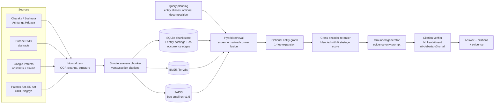

# AyurRAG — evidence-grounded Ayurveda & IPR research assistant

Hybrid RAG over Ayurvedic classical texts (Charaka, Sushruta, Ashtanga Hridaya),
PubMed/Europe PMC abstracts, Google Patents records, and Indian biodiversity/IPR
statutes (Patents Act 1970, Biological Diversity Act 2002, Nagoya Protocol).

Core principle: **Retrieve → Correlate → Explain → Cite → let the expert decide.**
The system never gives medical advice or legal conclusions; every legal statement is
surfaced as a *potentially relevant provision*.

## Architecture



- **Chunking**: classical texts are grouped by verse ranges, legal texts by section,
  literature by abstract; long units are split with overlap. Citations are exact
  (`Charaka Samhita, Sutra Sthana 1.1–1.3`, `Patents Act 1970, Section 3 — What are not inventions`).
- **Retrieval**: BM25 and dense scores are min-max normalized per query and fused
  with a convex combination (0.8 lexical / 0.2 dense by default), which beat
  equal-weight RRF on every metric. A cross-encoder reranks the top candidates and
  its score is blended 50/50 with the first-stage score, so lexical exact matches
  are not thrown away. Graph expansion and query decomposition are implemented and
  measurable but disabled by default: the combined variant improved
  `R@20` while hurting early precision.
- **Terminology**: a curated lexicon maps Sanskrit, transliterated, common and botanical
  names (`ashwagandha` ↔ `Withania somnifera` ↔ `asgandha`). Query planning can add
  alias-only and decomposed subqueries as separately weighted retrieval variants;
  entity co-occurrence edges (`entity_edges`) support one-hop graph expansion.
- **Generation**: the model receives only numbered evidence, must cite `[S#]` per sentence,
  must set `insufficient_evidence` when the corpus cannot answer, and is checked afterwards
  by an NLI cross-encoder (`cross-encoder/nli-deberta-v3-small`, premise=evidence).
- **Patents**: Google Patents blocks automated search from many hosts, so the ingester
  snowballs from 16 verified Ayurveda/herbal publication numbers through citations and
  similar-document links, reading pages via the public `r.jina.ai` reader when direct
  access is blocked. Only public abstracts/claims are stored.
- **Evaluation**: retrieval ablations (BM25 / dense / equal-RRF / convex hybrid /
  +rerank / full expansion+graph) and end-to-end LLM-judge scores, plus citation
  precision and refusal on unanswerable questions.

## Quickstart

```bash
uv venv --python 3.12 .venv
uv pip install -e .
ayurrag ingest                 # download/parse sources and chunk (~25k chunks)
ayurrag index                  # SQLite + BM25 + FAISS indexes
ayurrag ask "What does Charaka say about the three pillars of health?"
ayurrag search "ashwagandha clinical trials" --source pubmed
ayurrag serve                  # FastAPI on 127.0.0.1:8080
```

The LLM endpoint is OpenAI-compatible and configured in `configs/default.yaml`.
The default is DeepSeek's official API (`https://api.deepseek.com/v1`) with
`deepseek-flash` for both generation and the evaluation judge.
Put the bearer token in `.env`; it is gitignored and loaded automatically:

```bash
printf 'AYURRAG_LLM_API_KEY=%s\n' "$YOUR_KEY" >> .env
chmod 600 .env
ayurrag serve
```

A secondary OpenAI-compatible endpoint can be configured under `llm.fallback`.
When the primary returns an auth/request error, or keeps failing after retries,
the client retries generation and judge calls against the fallback with its own
model mapping. Its token is read from `AYURRAG_FALLBACK_API_KEY` (also in `.env`).
If that variable is absent the fallback is disabled with a warning.

```yaml
llm:
  fallback:
    name: wand
    base_url: https://api2.manojhv.tech/v1
    model: deepseek-v4.1-flash-free
    judge_model: deepseek-v4.1-flash-free
    api_key_env: AYURRAG_FALLBACK_API_KEY
    user_agent: opencode/1.18.0
```

You can still override the token with an exported `AYURRAG_LLM_API_KEY`; the
environment takes precedence over `.env`.

## Web UI and API

`ayurrag serve` (or `uvicorn ayurrag.api:app --port 8080`) serves a single-page
research interface at `http://127.0.0.1:8080/`. The UI exposes the corpus filter,
renders `[S#]` markers against the retrieved passages, and shows the stage-by-stage
retrieval trace: query variants, BM25/dense candidate counts, fusion, reranking,
evidence selection, generation and NLI citation verification. When the generator
sets `insufficient_evidence`, the API withholds the answer and returns a plain
"I don't know" message rather than displaying an unsupported explanation.

The same surface is available programmatically:

```http
POST /search   {"query": "...", "top_k": 8, "source": "charaka"}
POST /ask      {"query": "...", "top_k": 8, "source": "charaka", "verify": true}
GET  /health
```

`/ask` returns the answer, structured citations, evidence, and a `trace` object;
`/search` returns ranked evidence and the retrieval trace without calling the LLM.

## Evaluation

```bash
ayurrag eval --kind all --limit 60          # default retrieval + QA + external + refusal
ayurrag eval --kind retrieval --limit 180 --ablations  # full retrieval table
```

This builds a domain retrieval benchmark from held-out passages (queries generated
from a single passage, so the gold chunk is unique; the cached benchmark has 180
questions), runs retrieval ablations when asked, and judges end-to-end answers on
correctness, groundedness, completeness and citation quality. Results are written to
`data/artifacts/eval_report.{json,md}`. Judge scores are cached in SQLite, so re-runs
are cheap.

See [`docs/evaluation.md`](docs/evaluation.md) for the full protocol, every run,
per-source breakdowns, and caveats; `data/artifacts/eval_report.md` is the compact
generated report.

### End-to-end answer quality (60 domain questions)

Same pipeline as `ayurrag ask`; answers are scored by an independent LLM judge
(1–5) against the gold passage and the retrieved evidence, and citations are
checked by the NLI verifier and by the judge.

| metric | score |
|---|---|
| correctness | 4.58 / 5 |
| groundedness | 3.67 / 5 |
| completeness | 4.49 / 5 |
| citation quality (judge) | 3.42 / 5 |
| harmful overreach rate | 0.0 |
| answers with `insufficient_evidence` | 0.15 |
| citation coverage (sentences with a marker) | 0.890 |
| citation precision (NLI, strict) | 0.468 |
| refusal rate on 15 unanswerable questions | 1.00 |

`citation precision (NLI)` is deliberately conservative: a sentence is credited
only when its atomic claims are entailed by the cited passage under a small
CPU cross-encoder. Long, abstractive sentences and OCR/section fragments depress
it even when a human judge accepts the citation (judge citation quality 3.42/5).
Unsupported citations are surfaced as `supported: false` in the API rather than
silently removed; downstream users see exactly what the verifier flagged.

### External check: PubMedQA

To test out-of-domain grounding, the same generator and judge were run with the
**gold PubMedQA contexts** (48 questions; 16 each yes/no/maybe; MIT-licensed
fixture in `benchmarks/`). This isolates generation/citation behaviour from
domain retrieval.

| metric | score |
|---|---|
| correctness | 4.30 / 5 |
| groundedness | 4.96 / 5 |
| completeness | 3.89 / 5 |
| citation quality | 4.81 / 5 |
| harmful overreach rate | 0.0 |
| final decision mentioned | 0.3125 |

The low decision-mention rate is expected: the assistant is prompted to explain
evidence, not to emit a bare yes/no label. (`decision_mentioned` is a
token-boundary match; an earlier substring check inflated the value to 0.396
because `no` matched inside words such as `not`.) Completeness is lower than
groundedness because many gold answers include study-design details.

### Retrieval ablations (180 questions)

The benchmark is built from held-out passages across all five sources
(36 Charaka, 36 Sushruta, 38 PubMed, 34 patents, 36 legal; 93 natural questions,
87 terminology-heavy). Queries are generated from a passage, so the benchmark is
lexical by construction — BM25 is expected to be strong. Dense retrieval matters for
paraphrases that share few surface terms, which this benchmark under-represents.

| pipeline | R@5 | R@10 | R@20 | MRR@10 | nDCG@10 |
|---|---|---|---|---|---|
| BM25 | 0.944 | 0.967 | 0.967 | 0.860 | 0.886 |
| dense (bge-small-en-v1.5) | 0.811 | 0.839 | 0.878 | 0.723 | 0.751 |
| hybrid (equal-weight RRF) | 0.872 | 0.933 | 0.961 | 0.800 | 0.832 |
| hybrid convex fusion (0.8/0.2) | 0.950 | 0.961 | 0.967 | 0.874 | 0.895 |
| hybrid convex + cross-encoder rerank | 0.961 | 0.972 | 0.978 | 0.890 | 0.910 |
| **default: + alias expansion** | **0.961** | **0.972** | **0.978** | **0.888** | **0.909** |
| + subquery decomposition + entity graph | 0.961 | 0.972 | 0.978 | 0.888 | 0.909 |

The shipped answer pipeline is the convex hybrid + reranker: it beats BM25 on
every reported metric while keeping a semantic channel for paraphrases. The last
row adds graph/decomposition expansion but has no material gain over the default,
so that path remains opt-in (`graph_expansion: true`, `max_subqueries: 3`).
`ayurrag search` exposes `--no-rerank`, `--no-expansion` and source filters for
ablation-style use.

## Corpus and licensing

| Source | Content | License |
|---|---|---|
| Charaka Samhita (Sanskrit/English) | verses | public domain |
| Sushruta Samhita | passages | public domain |
| Ashtanga Hridaya | passages | public domain |
| Europe PMC / PubMed | titles + abstracts | NLM / publisher terms; metadata only |
| Google Patents | public patent abstracts/claims | public records |
| India Code / CBD / Nagoya | statutes and treaty text | Government of India / UN |

All data stays local in `data/`; no source text is redistributed in this repository.

## Limitations

- OCR artifacts remain in older classical-text scans; retrieval is robust but quotes should be
  checked against a critical edition.
- Legal chunk boundaries are approximate for PDFs with running headers.
- The NLI verifier is a small CPU model; it flags unsupported citations, not legal correctness.
- BhashaBench-Ayur is gated (HF terms); it is not bundled, so reported numbers use the in-repo benchmark.

## Layout

```
src/ayurrag/
  ingest/      source parsers (charaka, sushruta, pubmed, patents, legal)
  chunking.py  structure-aware chunking and citations
  lexicon.py   Ayurveda terminology/alias mapping
  index/       BM25 + FAISS builders
  retrieve/    query planning, convex fusion, graph expansion, reranking, MMR
  generate/    grounded answers, NLI citation verification
  eval/        benchmark builder, metrics, LLM judge, ablations
  api.py       FastAPI service
  cli.py       command line interface
```
