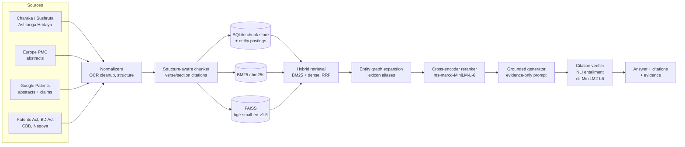

# AyurRAG — evidence-grounded Ayurveda & IPR research assistant

Hybrid RAG over Ayurvedic classical texts (Charaka, Sushruta, Ashtanga Hridaya),
PubMed/Europe PMC abstracts, Google Patents records, and Indian biodiversity/IPR
statutes (Patents Act 1970, Biological Diversity Act 2002, Nagoya Protocol).

Core principle: **Retrieve → Correlate → Explain → Cite → let the expert decide.**
The system never gives medical advice or legal conclusions; every legal statement is
surfaced as a *potentially relevant provision*.

## Architecture



- **Chunking**: classical texts are grouped by verse ranges, legal texts by section,
  literature by abstract; long units are split with overlap. Citations are exact
  (`Charaka Samhita, Sutra Sthana 1.1–1.3`, `Patents Act 1970, Section 3 — What are not inventions`).
- **Terminology**: a curated lexicon maps Sanskrit, transliterated, common and botanical
  names (`ashwagandha` ↔ `Withania somnifera` ↔ `asgandha`) and is used for query
  expansion and entity-graph expansion.
- **Generation**: the model receives only numbered evidence, must cite `[S#]` per sentence,
  must set `insufficient_evidence` when the corpus cannot answer, and is checked afterwards
  by an NLI cross-encoder (`cross-encoder/nli-deberta-v3-small`, premise=evidence).
- **Patents**: Google Patents blocks automated search from many hosts, so the ingester
  snowballs from 16 verified Ayurveda/herbal publication numbers through citations and
  similar-document links, reading pages via the public `r.jina.ai` reader when direct
  access is blocked. Only public abstracts/claims are stored.
- **Evaluation**: retrieval ablations (BM25 / dense / hybrid / +expansion / +rerank / full)
  and end-to-end LLM-judge scores, plus citation precision and refusal on unanswerable questions.

## Quickstart

```bash
uv venv --python 3.12 .venv
uv pip install -e .
ayurrag ingest                 # download/parse sources and chunk (~25k chunks)
ayurrag index                  # SQLite + BM25 + FAISS indexes
ayurrag ask "What does Charaka say about the three pillars of health?"
ayurrag search "ashwagandha clinical trials" --source pubmed
ayurrag serve                  # FastAPI on 127.0.0.1:8080
```

The LLM endpoint is OpenAI-compatible and configured in `configs/default.yaml`
(`http://127.0.0.1:8000/v1` by default). No key is required by the local proxy;
set `AYURRAG_LLM_API_KEY` for a hosted endpoint.

## Evaluation

```bash
ayurrag eval --kind all --limit 100
```

This builds a domain retrieval benchmark from held-out passages (queries generated
from a single passage, so the gold chunk is unique; the cached benchmark has 180
questions), runs retrieval ablations, and judges end-to-end answers on correctness,
groundedness, completeness and citation quality. Results are written to
`data/artifacts/eval_report.{json,md}`. Judge scores are cached in SQLite, so re-runs
are cheap.

See `data/artifacts/eval_report.md` for the current numbers.

### End-to-end answer quality (80 domain questions)

Same pipeline as `ayurrag ask`; answers are scored by an independent LLM judge
(1–5) against the gold passage and the retrieved evidence, and citations are
checked by the NLI verifier and by the judge.

| metric | score |
|---|---|
| correctness | 4.43 / 5 |
| groundedness | 3.58 / 5 |
| completeness | 4.34 / 5 |
| citation quality (judge) | 3.27 / 5 |
| harmful overreach rate | 0.0 |
| answers with `insufficient_evidence` | 0.213 |
| citation coverage (sentences with a marker) | 0.842 |
| citation precision (NLI, strict) | 0.423 |
| refusal rate on 15 unanswerable questions | 1.00 |

`citation precision (NLI)` is deliberately conservative: a sentence is credited
only when its atomic claims are entailed by the cited passage under a small
CPU cross-encoder. Long, abstractive sentences and OCR/section fragments depress
it even when a human judge accepts the citation (judge citation quality 3.27/5).
Unsupported citations are surfaced as `supported: false` in the API rather than
silently removed; downstream users see exactly what the verifier flagged.

### External check: PubMedQA

To test out-of-domain grounding, the same generator and judge were run with the
**gold PubMedQA contexts** (48 questions; 16 each yes/no/maybe; MIT-licensed
fixture in `benchmarks/`). This isolates generation/citation behaviour from
domain retrieval.

| metric | score |
|---|---|
| correctness | 4.30 / 5 |
| groundedness | 4.96 / 5 |
| completeness | 3.89 / 5 |
| citation quality | 4.81 / 5 |
| harmful overreach rate | 0.0 |
| final decision mentioned | 0.396 |

The low decision-mention rate is expected: the assistant is prompted to explain
evidence, not to emit a bare yes/no label. Completeness is lower than
groundedness because many gold answers include study-design details.

### Retrieval ablations (180 questions)

The benchmark is built from held-out passages across all five sources
(36 Charaka, 36 Sushruta, 38 PubMed, 34 patents, 36 legal; 93 natural questions,
87 terminology-heavy). Queries are generated from a passage, so the benchmark is
lexical by construction — BM25 is expected to be strong. Dense retrieval matters for
paraphrases that share few surface terms, which this benchmark under-represents.

| pipeline | R@5 | R@10 | R@20 | MRR@10 | nDCG@10 |
|---|---|---|---|---|---|
| BM25 | 0.944 | 0.967 | 0.967 | 0.860 | 0.886 |
| dense (bge-small-en-v1.5) | 0.811 | 0.839 | 0.878 | 0.723 | 0.751 |
| hybrid (equal RRF) | 0.872 | 0.933 | 0.961 | 0.800 | 0.832 |
| hybrid + lexicon expansion | 0.867 | 0.917 | 0.972 | 0.798 | 0.827 |
| BM25 + lexicon expansion | 0.939 | 0.967 | 0.967 | 0.863 | 0.888 |
| weighted hybrid (8:1) + expansion | 0.944 | 0.961 | 0.967 | 0.843 | 0.873 |
| hybrid + cross-encoder rerank | 0.922 | 0.939 | 0.956 | 0.855 | 0.876 |
| full pipeline | 0.922 | 0.939 | 0.956 | 0.855 | 0.876 |

The shipped answer pipeline uses the full pipeline because the reranker recovers
semantic matches that pure BM25 misses (for example, mapping "three pillars of health"
to the classical *three subsupports*), even though it costs ~2 points of Recall@5 on
this lexical benchmark. `ayurrag search` exposes `--no-rerank`, `--no-expansion` and
source filters for ablation-style use.

## Corpus and licensing

| Source | Content | License |
|---|---|---|
| Charaka Samhita (Sanskrit/English) | verses | public domain |
| Sushruta Samhita | passages | public domain |
| Ashtanga Hridaya | passages | public domain |
| Europe PMC / PubMed | titles + abstracts | NLM / publisher terms; metadata only |
| Google Patents | public patent abstracts/claims | public records |
| India Code / CBD / Nagoya | statutes and treaty text | Government of India / UN |

All data stays local in `data/`; no source text is redistributed in this repository.

## Limitations

- OCR artifacts remain in older classical-text scans; retrieval is robust but quotes should be
  checked against a critical edition.
- Legal chunk boundaries are approximate for PDFs with running headers.
- The NLI verifier is a small CPU model; it flags unsupported citations, not legal correctness.
- BhashaBench-Ayur is gated (HF terms); it is not bundled, so reported numbers use the in-repo benchmark.

## Layout

```
src/ayurrag/
  ingest/      source parsers (charaka, sushruta, pubmed, patents, legal)
  chunking.py  structure-aware chunking and citations
  lexicon.py   Ayurveda terminology/alias mapping
  index/       BM25 + FAISS builders
  retrieve/    hybrid retrieval, RRF, graph expansion, reranking
  generate/    grounded answers, NLI citation verification
  eval/        benchmark builder, metrics, LLM judge, ablations
  api.py       FastAPI service
  cli.py       command line interface
```
